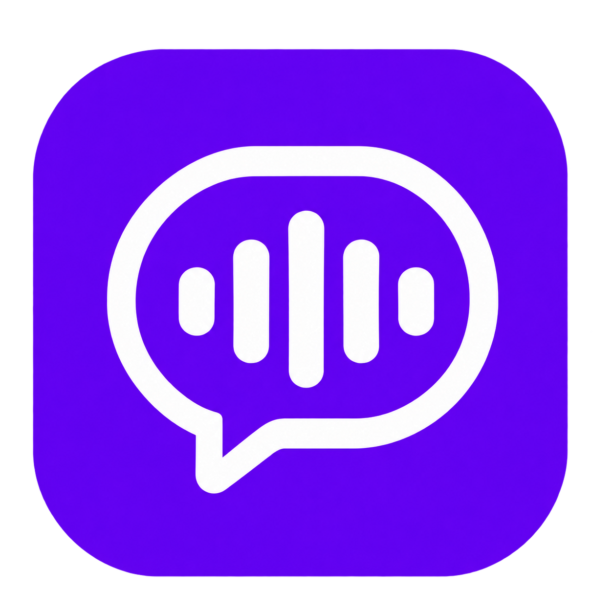
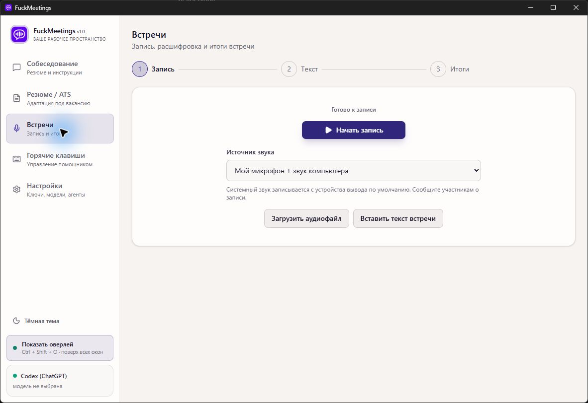
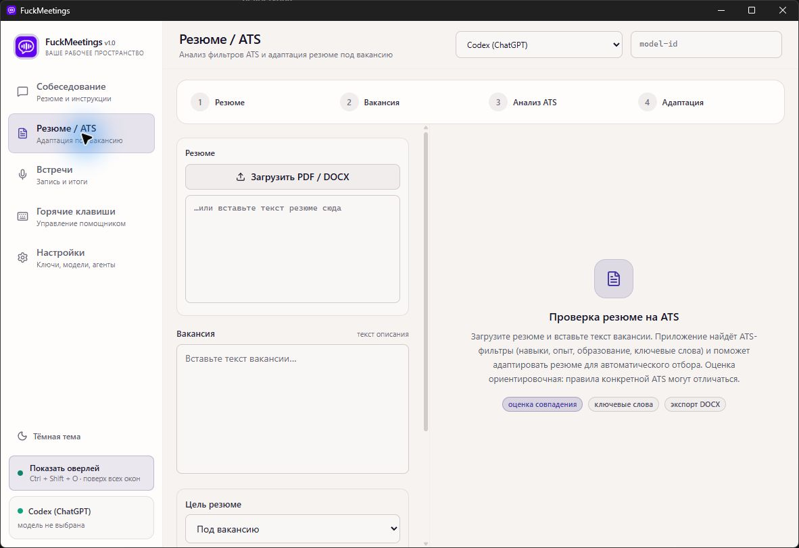
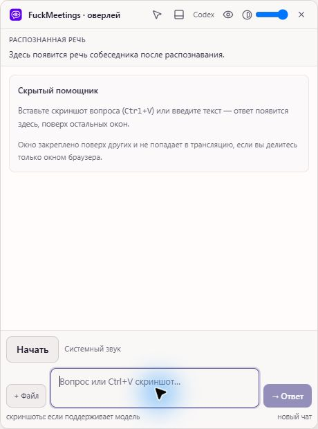

<div align="center">



# FuckMeetings

**Встречи, собеседования и резюме — в одном приложении.**

Записывайте и расшифровывайте встречи, получайте помощь во время собеседования и адаптируйте резюме под вакансию.

[Скачать последнюю версию](https://github.com/xxx359xxx/FuckMeetings/releases/latest) · [Возможности](#возможности) · [Установка](#установка) · [Для разработчиков](#для-разработчиков)

Windows x64 · macOS Apple Silicon · Open source

</div>

---

## Возможности

### 🎙️ Встречи — от записи до итогов

Запишите микрофон и системный звук, загрузите аудиофайл или вставьте готовый текст. Проверьте и исправьте расшифровку, затем попросите выбранную модель подготовить итоги. Для распознавания доступны облачные сервисы и локальный whisper.cpp с загружаемой моделью.



### 📄 Резюме и ATS

Загрузите PDF или DOCX, вставьте вакансию и получите ориентировочный анализ совпадения, ключевых слов и требований. Приложение поможет адаптировать резюме и сохранить результат в DOCX или PDF. Проверяйте итоговый текст: оценка не воспроизводит правила каждой системы отбора.



### 💬 Помощник на собеседовании

Добавьте контекст и пожелания к ответам, задавайте вопросы текстом, голосом или с помощью снимков экрана. Компактный оверлей работает поверх окон и управляется настраиваемыми горячими клавишами. Доступны модели OpenAI, Anthropic, Gemini, OpenRouter, Ollama и совместимые API, а также CLI-агенты Codex и Claude Code.



> Защита оверлея от захвата зависит от операционной системы и программы демонстрации и не гарантирует невидимость. Используйте приложение в рамках правил конкретного собеседования.

## Установка

Откройте [последний выпуск](https://github.com/xxx359xxx/FuckMeetings/releases/latest) и выберите файл для своей системы:

| Система | Файл | Установка |
| --- | --- | --- |
| Windows x64 | `*-x64-setup.exe` | Запустите установщик и следуйте его инструкциям. Требуется WebView2 Runtime. |
| macOS 13+ на Apple Silicon | `*_aarch64.dmg` | Откройте образ и перенесите приложение в «Программы». |

Другие файлы в выпуске используются для проверки и обновления приложения. Исходный код также доступен в разделе релиза. Для Intel Mac отдельной сборки пока нет.

## Первые шаги

1. Откройте **Настройки**, выберите провайдера и модель, при необходимости добавьте API-ключ и проверьте подключение.
2. Для встреч выберите транскрибатор: OpenAI-совместимый API, Deepgram или локальный whisper.cpp. Локальную модель можно скачать в приложении.
3. Для помощника добавьте контекст в разделе **Собеседование**. Горячие клавиши можно посмотреть и изменить в одноимённом разделе.
4. Для записи встречи выберите источник звука и сообщите участникам о записи. Проверьте дорожки и сохраните результат до закрытия приложения.

Для Codex через ChatGPT установите Codex CLI и подключите его в настройках. Возможности и лимиты зависят от аккаунта; транскрибация настраивается отдельно. Для Claude Code также необходим установленный CLI.

## Данные и приватность

У приложения нет собственного сервера: запросы отправляются напрямую выбранному провайдеру. Текст, изображения и аудио, которые вы отправляете облачной модели или транскрибатору, передаются соответствующему сервису. Локальная обработка зависит от выбранной модели и настроек.

API-ключи хранятся в локальном файле настроек **без шифрования**. Не показывайте их при демонстрации экрана. Встречи с несколькими собеседниками могут объединяться в одну дорожку; автоматическое определение каждого участника не гарантируется.

## Для разработчиков

Интерфейс построен на React и TypeScript, нативная часть — на Rust и Tauri 2.

**Необходимы:** Node.js 24, pnpm 11 и Rust из `rust-toolchain.toml`. На Windows потребуются Visual Studio Build Tools с компонентами C++ и WebView2 Runtime. На macOS Apple Silicon — Xcode, инструменты командной строки и CMake.

```bash
pnpm install --frozen-lockfile
pnpm tauri dev
```

Для сборки установщика:

```bash
# Только на macOS: подготовка нативных ресурсов звука и Whisper
bash scripts/build-macos-resources.sh

pnpm tauri build
```

Результат находится в `src-tauri/target/release/bundle/`. Процесс выпуска и подписанных обновлений описан в [документации](docs/RELEASE-UPDATES.md). Сборки Windows и macOS можно проверить через GitHub Actions.

### Если приложение Windows не открывается

Проверьте в диспетчере задач, не запущена ли другая копия `fuckmeetings.exe`: приложение использует один экземпляр и может передать управление уже работающей копии. Если запуск сборки из OneDrive вызывает ошибку WebView2, перенесите каталог сборки за пределы синхронизируемой папки, например задав `target-dir` в локальном `src-tauri/.cargo/config.toml`.

## Участие в проекте

Предложения и исправления приветствуются — см. [CONTRIBUTING.md](CONTRIBUTING.md). Распространяется под лицензией [MIT](LICENSE).
