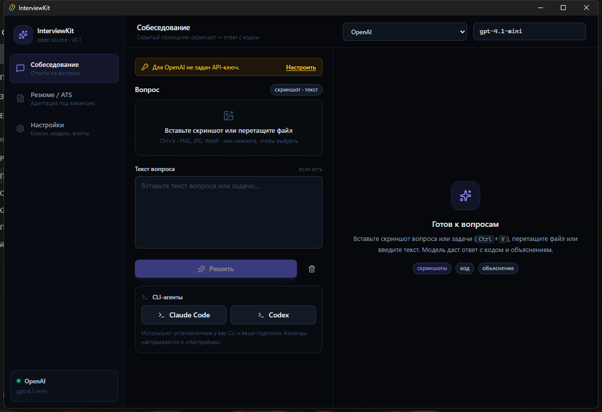
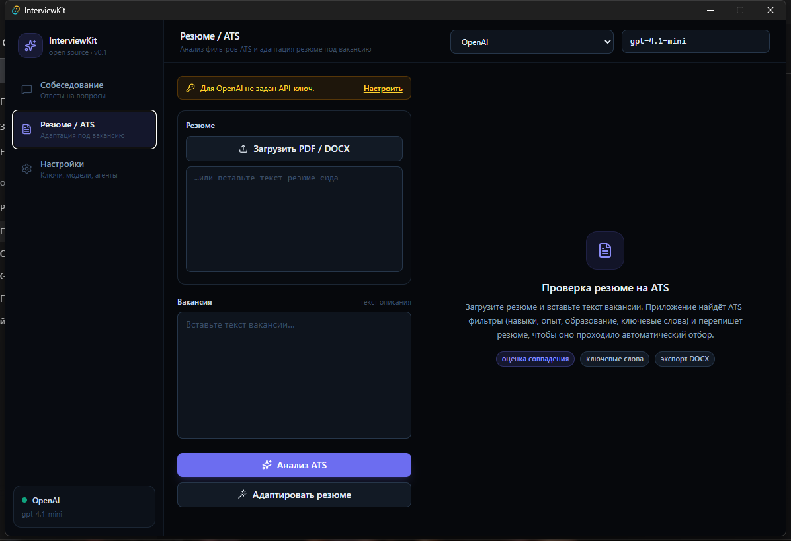
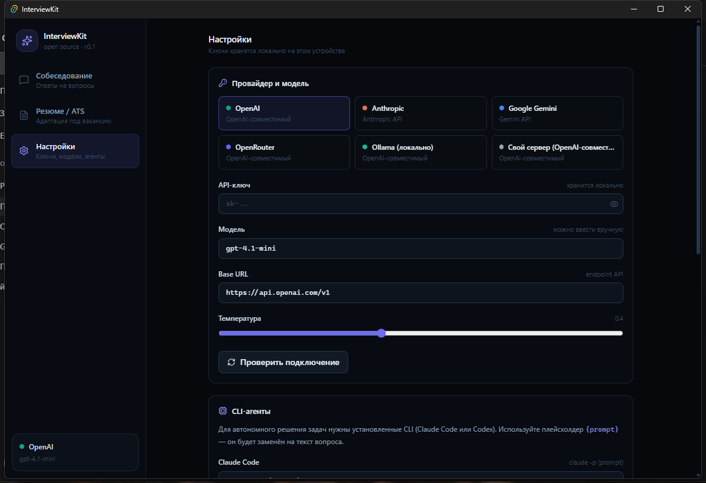
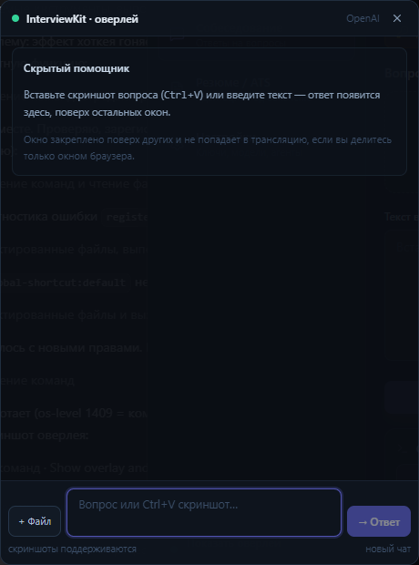

# FuckMeetings

Кроссплатформенное **open-source** приложение (Tauri 2 + React + TypeScript) с двумя модулями:

1. **Скрытый помощник на собеседовании** — вы вставляете скриншот вопроса или задачи, а приложение отвечает и пишет код. Поддерживаются визуальные вопросы (скриншоты), отдельное всегда-поверх-всех окно-оверлей с глобальной горячей клавишей и автономные CLI-агенты (Claude Code, Codex).
2. **Адаптация резюме под ATS** — вы загружаете резюме и вставляете текст вакансии; приложение находит ATS-фильтры (навыки, опыт, образование, ключевые слова), оценивает совпадение и переписывает резюме, после чего вы скачиваете готовый **DOCX** или **PDF**.

> ⚠️ Используйте инструмент ответственно и в рамках правил конкретного собеседования.

## Скриншоты

| Собеседование | Резюме / ATS | Настройки | Оверлей |
| --- | --- | --- | --- |
|  |  |  |  |


---

## Возможности

### Собеседование
- Ответы на вопросы по **тексту и скриншотам** (вставка `Ctrl+V`, drag-and-drop, выбор файла).
- Стриминг ответа в реальном времени, Markdown + подсветка кода.
- **Скрытый оверлей** — отдельное компактное окно **поверх всех окон**, без рамки и заголовка, с прозрачными краями; показывается/скрывается **глобальной горячей клавишей** (по умолчанию `Ctrl+Shift+Space`), кнопкой в сайдбаре или клавишей `Esc` внутри оверлея.
- **Claude Code** и **Codex** как автономные агенты для решения задач в вашем терминале.
- Любой провайдер: OpenAI, Anthropic, Google Gemini, OpenRouter, Ollama (локально), свой OpenAI-совместимый endpoint.

### Резюме / ATS
- Извлечение текста из **PDF** и **DOCX** локально.
- Анализ ATS-фильтров вакансии с **оценкой совпадения (0–100)**.
- Список совпавших и отсутствующих ключевых слов, конкретные фильтры и рекомендации.
- Переписывание резюме под вакансию **без выдумывания фактов**.
- Экспорт в **DOCX** и **PDF** (PDF генерируется локально со встроенным системным шрифтом — текст остаётся выделяемым и ATS-читаемым).

---

## Архитектура и приватность

- **Нет своего сервера.** Все запросы идут напрямую выбранному провайдеру из Rust-бэкенда (reqwest), поэтому нет CORS и нет посредников.
- **Ключи хранятся локально** в каталоге данных приложения (JSON). В v1.0 — без шифрования (см. ниже).
- Резюме и вакансии не покидают устройство, кроме отправки в выбранную вами модель.
- Рендер UI — React; вся работа с API и файлами — нативные команды Tauri.

### Поддерживаемые провайдеры

| Провайдер | Протокол | Ключ |
| --- | --- | --- |
| OpenAI | OpenAI-compatible | ✅ |
| Anthropic | Anthropic Messages | ✅ |
| Google Gemini | Gemini streamGenerateContent | ✅ |
| OpenRouter | OpenAI-compatible | ✅ |
| Ollama | OpenAI-compatible | ❌ (локально) |
| Custom | OpenAI-compatible | опционально |

---

## Оверлей: как это работает и ограничения

Оверлей — это **второе окно Tauri** (`label: "overlay"`), созданное с флагами:

- `alwaysOnTop` — поверх других окон;
- `decorations: false` — без рамки и заголовка;
- `transparent: true` + `shadow: false` — прозрачные углы, компактная карточка;
- `skipTaskbar: true` — не виден в панели задач;
- `visible: false` при старте — не мешает до вызова.

Горячая клавиша по умолчанию — `Ctrl+Shift+Space` (`CommandOrControl+Shift+Space`); её можно поменять в **Настройках** (другая комбинация регистрируется глобально и работает даже когда приложение не в фокусе). Если комбинация уже занята другой программой, приложение сообщит об этом в сайдбаре.

**Честно про «невидимость»:** в оверлее есть переключатель защиты от захвата и настройка прозрачности. Защита зависит от операционной системы и программы захвата и не гарантирует невидимость: проверяйте её в конкретной программе до демонстрации. Для демонстрации конкретного окна или приложения оверлей обычно не мешает; для полноэкранного шаринга — скройте его горячей клавишей на время. Прозрачность работает на Windows (DWM) и macOS; на macOS включён `macOSPrivateApi`, поэтому дистрибутив для **прямой установки** (`.dmg`) корректен, но такой билд **не проходит ревью Mac App Store**.

---

## Быстрый старт (разработка)

Требования:

- [Rust](https://rustup.rs/) (stable, MSVC toolchain на Windows)
- [Node.js](https://nodejs.org/) 20+ и pnpm (или npm)
- На Windows — [Visual Studio Build Tools](https://visualstudio.microsoft.com/visual-cpp-build-tools/) с «Desktop development with C++» и WebView2 runtime.

```bash
pnpm install
pnpm tauri dev
```

## Сборка установщика

```bash
pnpm tauri build
```

Артефакты появятся в `src-tauri/target/release/bundle/`.

---

## Устранение неполадок

### Windows: «Failed to setup app: Access is denied / resource busy» при старте

WebView2 **не может создать папку данных на пути, синхронизируемом OneDrive** (или на сетевом диске). Симптомы: паника `Failed to setup app` с `os error 5` (Access is denied) или `HRESULT 0x800700AA` (ресурс занят).

Решение — держать build-артефакты вне OneDrive. Создайте `src-tauri/.cargo/config.toml` (он в `.gitignore`):

```toml
[build]
target-dir = "C:/Users/<you>/AppData/Local/interview-kit-target"
```

и пересоберите проект. Сами исходники могут оставаться в OneDrive; приложение будет запускаться из `AppData\Local`, где WebView2 работает корректно.

Альтернатива — склонировать проект в обычную локальную папку (например, `C:\dev\interview-kit`).

> Приложение также перенаправляет свою WebView2-папку данных в `%LOCALAPPDATA%\InterviewKit\WebView2`, чтобы кэш WebView2 не зависел от расположения установки.

### Windows: кириллица в пути

Путь с не-ASCII символами сам по себе поддерживается (проверено на `C:\Temp\тест`), проблема именно в OneDrive.

---

## Настройка провайдера

1. Откройте **Настройки**.
2. Выберите провайдера.
3. Вставьте API-ключ (сохраняется локально).
4. При необходимости укажите модель и Base URL (для Ollama — `http://localhost:11434/v1`, для своего endpoint — свой URL).
5. Нажмите **Проверить подключение**.

CLI-агенты требуют установленных `claude` (Claude Code) или `codex` (OpenAI Codex CLI) и работают через команды вида `claude -p {prompt}` / `codex exec {prompt}` — `{prompt}` подставляется автоматически.

---

## Структура проекта

```
interview-kit/
├── src/                    # React-фронтенд
│   ├── components/         # Sidebar, Markdown, UI-примитивы
│   ├── pages/              # InterviewPage, ResumePage, SettingsPage, OverlayPage
│   ├── lib/                # providers, prompts, settings, llm, agents, resume, pdf, overlay
│   └── App.tsx             # роутинг окон: main / overlay
└── src-tauri/
    ├── src/                # Rust-бэкенд
    │   ├── lib.rs          # точки входа, AppState, плагины
    │   ├── llm.rs          # OpenAI / Anthropic / Gemini, SSE-стриминг
    │   ├── agents.rs       # запуск Claude Code / Codex
    │   └── files.rs        # чтение/запись файлов (base64)
    └── capabilities/       # разрешения Tauri
```

---

## Безопасность (v1.0)

- API-ключи хранятся в локальном JSON **без шифрования** — не храните чужие ключи и не показывайте экран настроек при демонстрации/трансляции.
- Шифрование ключей (через системное хранилище/OS keychain) запланировано.

## Roadmap

- Нативные скриншоты выделенной области.
- Шифрование ключей в OS keychain.
- Пакетирование для macOS (универсальный `.dmg`, подпись/нотаризация).

## Лицензия

[MIT](./LICENSE)


## Встречи и транскрибация

Раздел «Встречи» позволяет выбрать аудиофайл или записать встречу. В Windows запись по умолчанию использует две дорожки: микрофон и системный звук устройства вывода по умолчанию (наушники). В других системах захват звука зависит от поддержки системы. Сохраните запись до закрытия приложения. В разделе «Настройки» выберите транскрибатор. Для распознавания используйте OpenAI-совместимый API `/v1/audio/transcriptions` или локальную программу whisper.cpp: укажите `whisper-cli` и файл модели GGML. Локальный CLI принимает WAV PCM 16 кГц mono; записи, сделанные в локальном режиме, приложение преобразует в WAV; загружаемые файлы должны быть WAV. Качество и наличие звука экрана зависят от устройства и настроек Windows. Расшифровку можно поправить и сохранить; итоги с решениями и поручениями готовит выбранная текстовая модель.

## Codex через ChatGPT

Установите Codex CLI и войдите в него через ChatGPT, затем выберите «Codex (ChatGPT)» как провайдера. Пустое поле модели использует настройки CLI. Этот режим отправляет текст в Codex и зависит от возможностей и лимитов аккаунта; изображения в нём пока не поддерживаются. API для транскрибации настраивается отдельно и не использует автоматически подписку ChatGPT.

Для Deepgram выберите «Deepgram» в настройках транскрибатора, укажите ключ Deepgram и модель `nova-3`. Адрес сервиса подставляется автоматически; аудио отправляется в Deepgram. Язык `ru` включает распознавание русского.

В настройках транскрибатора можно явно сохранить параметры и проверить ключ Deepgram. В интервью и оверлее кнопка «Слушать» использует тот же транскрибатор, что и встречи: речь записывается фрагментами примерно по 10 секунд и добавляется в поле вопроса, после чего вопрос отправляется вручную. Источник звука выбирается отдельно; доступность звука экрана зависит от Windows и WebView2.

В записи встречи две дорожки распознаются по отдельности: «Мой микрофон» и «Собеседники / звук наушников». Перед саммари можно проверить их и исправить расшифровку. Все собеседники могут находиться на одной дорожке; автоматического определения конкретных людей и точного порядка реплик здесь нет. Дорожки находятся в памяти до сохранения; длинные записи требуют больше памяти. Сервис OpenAI ограничивает размер одного файла 25 МБ. Наушники должны быть устройством вывода Windows по умолчанию; проверьте индикатор и прослушайте запись.
